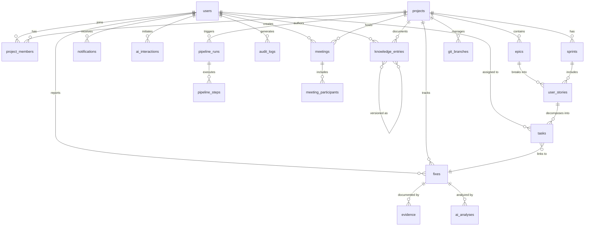

# Database Schema — DashNode

> **Note:** DashNode is a fully client-side SPA. There is no real database. All data is persisted via `localStorage` using JSON serialization. This document describes the logical schema of every entity as if it were a relational database, enabling future migration to a real backend (PostgreSQL, Supabase, etc.).

---

## Table of Contents

1. [Domain Overview](#domain-overview)
2. [Auth & Users Domain](#auth--users-domain)
3. [Projects Domain](#projects-domain)
4. [Scrum Domain](#scrum-domain)
5. [Meetings Domain](#meetings-domain)
6. [Fixes Domain](#fixes-domain)
7. [Knowledge Base Domain](#knowledge-base-domain)
8. [DevOps Domain](#devops-domain)
9. [Notifications & Audit Domain](#notifications--audit-domain)
10. [AI Domain](#ai-domain)
11. [Entity Relationship Diagram](#entity-relationship-diagram)
12. [Indexes & Constraints](#indexes--constraints)
13. [Business Rules](#business-rules)

---

## Domain Overview

| Domain | Entities | Purpose |
|--------|----------|---------|
| Auth & Users | User, Session | Identity, roles, authentication |
| Projects | Project, ProjectMember | Project lifecycle management |
| Scrum | Epic, UserStory, Task, Sprint | Agile work breakdown |
| Meetings | Meeting, MeetingParticipant | Scheduling and minutes |
| Fixes | Fix, Evidence, AIAnalysis | Issue tracking and resolution |
| Knowledge | KnowledgeEntry, KnowledgeTag | RAG-style knowledge base |
| DevOps | PipelineRun, PipelineStep, GitBranch | CI/CD visualization |
| Notifications | Notification | In-app alerts |
| AI | AIInteraction | Interaction log |
| Audit | AuditLog | Change history |

---

## Auth & Users Domain

### Table: `users`

| Column | Type | Nullable | Default | Description |
|--------|------|----------|---------|-------------|
| `id` | `string (UUID)` | No | generated | Primary key |
| `name` | `string` | No | — | Full display name |
| `email` | `string` | No | — | Unique login identifier |
| `password_hash` | `string` | No | — | Simulated hash (plaintext in LS) |
| `role` | `enum` | No | `'developer'` | One of `'admin' \| 'manager' \| 'developer'` |
| `avatar_url` | `string` | Yes | `null` | Profile picture URL or initials fallback |
| `is_active` | `boolean` | No | `true` | Soft-delete / suspension flag |
| `created_at` | `ISO8601` | No | now() | Account creation timestamp |
| `updated_at` | `ISO8601` | No | now() | Last update timestamp |

**Constraints:**
- `email` must be unique across all users
- `role` must be one of `admin`, `manager`, `developer`
- Only one user may hold `admin` role in current implementation

**Seeded users (initial data):**

| id | name | email | role |
|----|------|-------|------|
| `user-1` | Andrey Quiceno | andrey@dashnode.dev | admin |
| `user-2` | Jhorman Gómez | jhorman@dashnode.dev | manager |
| `user-3` | Valentina Restrepo | valentina@dashnode.dev | manager |
| `user-4` | Iván Ausecha | ivan@dashnode.dev | developer |
| `user-5` | David Enciso | david@dashnode.dev | developer |
| `user-6` | Carlos Montoya | carlos@dashnode.dev | developer |

---

### Table: `sessions` (simulated)

| Column | Type | Nullable | Default | Description |
|--------|------|----------|---------|-------------|
| `id` | `string` | No | generated | Session token |
| `user_id` | `string (FK)` | No | — | References `users.id` |
| `created_at` | `ISO8601` | No | now() | Login time |
| `expires_at` | `ISO8601` | No | +8h | Expiry (not enforced in LS) |

**Storage key:** `dashnode_current_user` (stores the full user object)

---

## Projects Domain

### Table: `projects`

| Column | Type | Nullable | Default | Description |
|--------|------|----------|---------|-------------|
| `id` | `string (UUID)` | No | generated | Primary key |
| `name` | `string` | No | — | Project title (max 100 chars) |
| `description` | `string` | Yes | `''` | Project summary |
| `status` | `enum` | No | `'planning'` | `'planning' \| 'active' \| 'on-hold' \| 'completed' \| 'cancelled'` |
| `priority` | `enum` | No | `'medium'` | `'low' \| 'medium' \| 'high' \| 'critical'` |
| `manager_id` | `string (FK)` | No | — | References `users.id` (must be manager or admin) |
| `start_date` | `ISO8601` | Yes | `null` | Project start date |
| `end_date` | `ISO8601` | Yes | `null` | Target completion date |
| `tech_stack` | `string[]` | No | `[]` | Technology tags |
| `repository_url` | `string` | Yes | `null` | Git repository link |
| `created_at` | `ISO8601` | No | now() | Creation timestamp |
| `updated_at` | `ISO8601` | No | now() | Last modification |
| `created_by` | `string (FK)` | No | — | References `users.id` |

**Business rules:**
- `end_date` must be after `start_date` if both provided
- Only admin/manager may create or delete projects
- Deletion cascades to all child entities

---

### Table: `project_members`

| Column | Type | Nullable | Default | Description |
|--------|------|----------|---------|-------------|
| `id` | `string` | No | generated | Primary key |
| `project_id` | `string (FK)` | No | — | References `projects.id` |
| `user_id` | `string (FK)` | No | — | References `users.id` |
| `role_in_project` | `enum` | No | `'developer'` | `'manager' \| 'developer' \| 'observer'` |
| `joined_at` | `ISO8601` | No | now() | Membership start |

**Constraints:** Unique constraint on `(project_id, user_id)`

---

## Scrum Domain

### Table: `epics`

| Column | Type | Nullable | Default | Description |
|--------|------|----------|---------|-------------|
| `id` | `string` | No | generated | Primary key |
| `project_id` | `string (FK)` | No | — | References `projects.id` |
| `title` | `string` | No | — | Epic title |
| `description` | `string` | Yes | `''` | Epic description |
| `status` | `enum` | No | `'open'` | `'open' \| 'in-progress' \| 'completed'` |
| `priority` | `enum` | No | `'medium'` | `'low' \| 'medium' \| 'high' \| 'critical'` |
| `color` | `string` | Yes | `'#6366F1'` | Hex color for visual grouping |
| `order` | `number` | No | `0` | Display order within project |
| `created_at` | `ISO8601` | No | now() | — |
| `updated_at` | `ISO8601` | No | now() | — |
| `created_by` | `string (FK)` | No | — | References `users.id` |

---

### Table: `user_stories`

| Column | Type | Nullable | Default | Description |
|--------|------|----------|---------|-------------|
| `id` | `string` | No | generated | Primary key |
| `epic_id` | `string (FK)` | No | — | References `epics.id` |
| `project_id` | `string (FK)` | No | — | References `projects.id` (denormalized) |
| `title` | `string` | No | — | Story title |
| `description` | `string` | Yes | `''` | As a [role], I want [goal]... |
| `acceptance_criteria` | `string` | Yes | `''` | DoD criteria |
| `story_points` | `number` | Yes | `null` | Fibonacci scale (1,2,3,5,8,13,21) |
| `status` | `enum` | No | `'todo'` | `'todo' \| 'in-progress' \| 'completed'` |
| `priority` | `enum` | No | `'medium'` | `'low' \| 'medium' \| 'high' \| 'critical'` |
| `assignee_id` | `string (FK)` | Yes | `null` | References `users.id` |
| `sprint_id` | `string (FK)` | Yes | `null` | References `sprints.id` (null = backlog) |
| `order` | `number` | No | `0` | Display order within epic |
| `created_at` | `ISO8601` | No | now() | — |
| `updated_at` | `ISO8601` | No | now() | — |
| `created_by` | `string (FK)` | No | — | References `users.id` |

---

### Table: `tasks`

| Column | Type | Nullable | Default | Description |
|--------|------|----------|---------|-------------|
| `id` | `string` | No | generated | Primary key |
| `story_id` | `string (FK)` | No | — | References `user_stories.id` |
| `project_id` | `string (FK)` | No | — | Denormalized for queries |
| `sprint_id` | `string (FK)` | Yes | `null` | Denormalized sprint reference |
| `title` | `string` | No | — | Task title |
| `description` | `string` | Yes | `''` | Detailed description |
| `status` | `TaskStatus` | No | `'todo'` | See enum below |
| `priority` | `enum` | No | `'medium'` | `'low' \| 'medium' \| 'high' \| 'critical'` |
| `assignee_id` | `string (FK)` | Yes | `null` | References `users.id` |
| `estimated_hours` | `number` | Yes | `null` | Original estimate |
| `actual_hours` | `number` | Yes | `null` | Time spent |
| `due_date` | `ISO8601` | Yes | `null` | Deadline |
| `tags` | `string[]` | No | `[]` | Free-form labels |
| `order` | `number` | No | `0` | Kanban column order |
| `fix_id` | `string (FK)` | Yes | `null` | Linked Fix if in 'fixing' status |
| `created_at` | `ISO8601` | No | now() | — |
| `updated_at` | `ISO8601` | No | now() | — |
| `created_by` | `string (FK)` | No | — | References `users.id` |

**TaskStatus enum:**
```typescript
type TaskStatus = 'todo' | 'in-progress' | 'code-review' | 'testing' | 'fixing' | 'completed'
```

> Note: `'fixing'` replaces the traditional `'blocked'` status. A task enters `fixing` when linked to an open Fix entity.

---

### Table: `sprints`

| Column | Type | Nullable | Default | Description |
|--------|------|----------|---------|-------------|
| `id` | `string` | No | generated | Primary key |
| `project_id` | `string (FK)` | No | — | References `projects.id` |
| `name` | `string` | No | — | e.g. "Sprint 1" |
| `goal` | `string` | Yes | `''` | Sprint objective |
| `status` | `enum` | No | `'planning'` | `'planning' \| 'active' \| 'completed' \| 'cancelled'` |
| `start_date` | `ISO8601` | Yes | `null` | Sprint start |
| `end_date` | `ISO8601` | Yes | `null` | Sprint end (2 weeks typical) |
| `velocity` | `number` | Yes | `null` | Story points completed |
| `capacity` | `number` | Yes | `null` | Team capacity in hours |
| `order` | `number` | No | `0` | Sprint sequence number |
| `created_at` | `ISO8601` | No | now() | — |
| `created_by` | `string (FK)` | No | — | References `users.id` |

**Business rules:**
- Only one sprint per project may be `'active'` at a time
- `'completed'` sprints are read-only
- Stories unfinished at sprint end remain linked to sprint (velocity counted as incomplete)

---

## Meetings Domain

### Table: `meetings`

| Column | Type | Nullable | Default | Description |
|--------|------|----------|---------|-------------|
| `id` | `string` | No | generated | Primary key |
| `project_id` | `string (FK)` | Yes | `null` | Null = cross-project/org meeting |
| `title` | `string` | No | — | Meeting title |
| `type` | `enum` | No | `'general'` | `'daily' \| 'planning' \| 'review' \| 'retro' \| 'general'` |
| `status` | `enum` | No | `'scheduled'` | `'scheduled' \| 'in-progress' \| 'completed' \| 'cancelled'` |
| `creator_id` | `string (FK)` | No | — | References `users.id` |
| `scheduled_at` | `ISO8601` | No | — | Date and time of meeting |
| `duration_minutes` | `number` | No | `60` | Expected duration |
| `location` | `string` | Yes | `null` | Physical or virtual location |
| `meeting_url` | `string` | Yes | `null` | Video call link |
| `agenda` | `string` | Yes | `''` | Pre-meeting agenda |
| `summary` | `string` | Yes | `null` | Post-meeting notes |
| `minutes_url` | `string` | Yes | `null` | Link to formal minutes document |
| `sprint_id` | `string (FK)` | Yes | `null` | Associated sprint (for ceremonies) |
| `created_at` | `ISO8601` | No | now() | — |
| `updated_at` | `ISO8601` | No | now() | — |

**Business rules:**
- Only `creator_id` may cancel or delete a meeting
- `summary` and `minutes_url` are editable only after meeting is `'completed'`
- Managers and admins may create org-wide meetings (null `project_id`)

---

### Table: `meeting_participants`

| Column | Type | Nullable | Default | Description |
|--------|------|----------|---------|-------------|
| `id` | `string` | No | generated | Primary key |
| `meeting_id` | `string (FK)` | No | — | References `meetings.id` |
| `user_id` | `string (FK)` | No | — | References `users.id` |
| `rsvp_status` | `enum` | No | `'pending'` | `'pending' \| 'accepted' \| 'declined'` |
| `attended` | `boolean` | Yes | `null` | Post-meeting attendance confirmation |

---

### Table: `availability`

| Column | Type | Nullable | Default | Description |
|--------|------|----------|---------|-------------|
| `id` | `string` | No | generated | Primary key |
| `user_id` | `string (FK)` | No | — | References `users.id` |
| `week_start` | `ISO8601` | No | — | Monday of the week (date only) |
| `slots` | `AvailabilitySlot[]` | No | `[]` | Array of hourly slots |

**AvailabilitySlot structure:**
```typescript
interface AvailabilitySlot {
  day: 0 | 1 | 2 | 3 | 4 | 5 | 6; // 0=Sun, 1=Mon...
  hour: number; // 0-23
  available: boolean;
}
```

---

## Fixes Domain

### Table: `fixes`

| Column | Type | Nullable | Default | Description |
|--------|------|----------|---------|-------------|
| `id` | `string` | No | generated | Primary key |
| `project_id` | `string (FK)` | No | — | References `projects.id` |
| `task_id` | `string (FK)` | Yes | `null` | Originating task (if from Kanban) |
| `title` | `string` | No | — | Short issue description |
| `description` | `string` | Yes | `''` | Full problem description |
| `status` | `FixStatus` | No | `'open'` | See enum below |
| `severity` | `enum` | No | `'medium'` | `'low' \| 'medium' \| 'high' \| 'critical'` |
| `type` | `enum` | No | `'bug'` | `'bug' \| 'regression' \| 'performance' \| 'security' \| 'ux'` |
| `assignee_id` | `string (FK)` | Yes | `null` | References `users.id` |
| `reporter_id` | `string (FK)` | No | — | References `users.id` |
| `environment` | `string` | Yes | `null` | e.g. "staging", "production" |
| `steps_to_reproduce` | `string` | Yes | `''` | Reproduction steps |
| `expected_behavior` | `string` | Yes | `''` | What should happen |
| `actual_behavior` | `string` | Yes | `''` | What actually happens |
| `resolution` | `string` | Yes | `null` | How it was resolved |
| `resolved_at` | `ISO8601` | Yes | `null` | Resolution timestamp |
| `created_at` | `ISO8601` | No | now() | — |
| `updated_at` | `ISO8601` | No | now() | — |

**FixStatus enum:**
```typescript
type FixStatus = 'open' | 'in-progress' | 'resolved' | 'closed'
```

---

### Table: `evidence`

| Column | Type | Nullable | Default | Description |
|--------|------|----------|---------|-------------|
| `id` | `string` | No | generated | Primary key |
| `fix_id` | `string (FK)` | No | — | References `fixes.id` |
| `type` | `enum` | No | `'screenshot'` | `'screenshot' \| 'log' \| 'video' \| 'other'` |
| `title` | `string` | No | — | Evidence label |
| `content` | `string` | No | — | URL or base64 encoded data |
| `mime_type` | `string` | Yes | `null` | e.g. "image/png" |
| `uploaded_by` | `string (FK)` | No | — | References `users.id` |
| `uploaded_at` | `ISO8601` | No | now() | — |

---

### Table: `ai_analyses`

| Column | Type | Nullable | Default | Description |
|--------|------|----------|---------|-------------|
| `id` | `string` | No | generated | Primary key |
| `fix_id` | `string (FK)` | No | — | References `fixes.id` |
| `prompt` | `string` | No | — | Input prompt sent to AI |
| `response` | `string` | No | — | AI-generated analysis |
| `model` | `string` | No | `'claude-3-5-sonnet'` | AI model used |
| `tokens_used` | `number` | Yes | `null` | Token consumption |
| `confidence` | `number` | Yes | `null` | 0–1 confidence score |
| `suggestions` | `string[]` | No | `[]` | Actionable fix suggestions |
| `human_validated` | `boolean` | No | `false` | Must be validated before action |
| `validated_by` | `string (FK)` | Yes | `null` | References `users.id` |
| `validated_at` | `ISO8601` | Yes | `null` | — |
| `created_at` | `ISO8601` | No | now() | — |

---

## Knowledge Base Domain

### Table: `knowledge_entries`

| Column | Type | Nullable | Default | Description |
|--------|------|----------|---------|-------------|
| `id` | `string` | No | generated | Primary key |
| `project_id` | `string (FK)` | Yes | `null` | Null = global knowledge |
| `title` | `string` | No | — | Entry title |
| `content` | `string` | No | — | Markdown content body |
| `category` | `DocCategory` | No | `'general'` | See enum below |
| `approval_status` | `ApprovalStatus` | No | `'pending'` | See enum below |
| `author_id` | `string (FK)` | No | — | References `users.id` |
| `approved_by` | `string (FK)` | Yes | `null` | References `users.id` |
| `approved_at` | `ISO8601` | Yes | `null` | Approval timestamp |
| `rejection_reason` | `string` | Yes | `null` | Reason if rejected |
| `tags` | `string[]` | No | `[]` | Searchable tags |
| `view_count` | `number` | No | `0` | Read analytics |
| `version` | `number` | No | `1` | Document version |
| `parent_id` | `string (FK)` | Yes | `null` | For versioned revisions |
| `is_pinned` | `boolean` | No | `false` | Featured content |
| `created_at` | `ISO8601` | No | now() | — |
| `updated_at` | `ISO8601` | No | now() | — |

**DocCategory enum:**
```typescript
type DocCategory = 'technical' | 'functional' | 'meeting' | 'general' | 'prompt'
```

**ApprovalStatus enum:**
```typescript
type ApprovalStatus = 'pending' | 'approved' | 'rejected'
```

**Business rules:**
- Only `'approved'` entries are visible to developers
- Only admin/manager may approve or reject entries
- Author cannot approve their own entry
- Rejected entries may be revised and resubmitted (status resets to `'pending'`)

---

## DevOps Domain

### Table: `pipeline_runs`

| Column | Type | Nullable | Default | Description |
|--------|------|----------|---------|-------------|
| `id` | `string` | No | generated | Primary key |
| `project_id` | `string (FK)` | No | — | References `projects.id` |
| `branch` | `string` | No | — | Git branch name |
| `commit_sha` | `string` | Yes | `null` | Short commit hash |
| `commit_message` | `string` | Yes | `null` | Last commit message |
| `triggered_by` | `string (FK)` | No | — | References `users.id` |
| `trigger_type` | `enum` | No | `'push'` | `'push' \| 'manual' \| 'schedule' \| 'pr'` |
| `status` | `enum` | No | `'pending'` | `'pending' \| 'running' \| 'success' \| 'failed' \| 'cancelled'` |
| `duration_seconds` | `number` | Yes | `null` | Total run time |
| `started_at` | `ISO8601` | Yes | `null` | Execution start |
| `completed_at` | `ISO8601` | Yes | `null` | Execution end |
| `created_at` | `ISO8601` | No | now() | — |

---

### Table: `pipeline_steps`

| Column | Type | Nullable | Default | Description |
|--------|------|----------|---------|-------------|
| `id` | `string` | No | generated | Primary key |
| `run_id` | `string (FK)` | No | — | References `pipeline_runs.id` |
| `name` | `string` | No | — | Step name (e.g. "Lint", "Test", "Build") |
| `type` | `enum` | No | `'script'` | `'lint' \| 'test' \| 'build' \| 'deploy' \| 'quality-gate' \| 'script'` |
| `status` | `enum` | No | `'pending'` | `'pending' \| 'running' \| 'success' \| 'failed' \| 'skipped'` |
| `order` | `number` | No | `0` | Step sequence |
| `duration_seconds` | `number` | Yes | `null` | Step execution time |
| `logs` | `string` | Yes | `null` | Step output log |
| `error_message` | `string` | Yes | `null` | Failure reason |
| `coverage_pct` | `number` | Yes | `null` | Code coverage (for test steps) |
| `quality_gate_passed` | `boolean` | Yes | `null` | Quality gate result |

---

### Table: `git_branches`

| Column | Type | Nullable | Default | Description |
|--------|------|----------|---------|-------------|
| `id` | `string` | No | generated | Primary key |
| `project_id` | `string (FK)` | No | — | References `projects.id` |
| `name` | `string` | No | — | Branch name |
| `type` | `enum` | No | `'feature'` | `'main' \| 'develop' \| 'feature' \| 'hotfix' \| 'release'` |
| `status` | `enum` | No | `'active'` | `'active' \| 'merged' \| 'deleted'` |
| `base_branch` | `string` | Yes | `null` | Parent branch name |
| `author_id` | `string (FK)` | No | — | References `users.id` |
| `created_at` | `ISO8601` | No | now() | — |
| `merged_at` | `ISO8601` | Yes | `null` | Merge timestamp |

---

## Notifications & Audit Domain

### Table: `notifications`

| Column | Type | Nullable | Default | Description |
|--------|------|----------|---------|-------------|
| `id` | `string` | No | generated | Primary key |
| `user_id` | `string (FK)` | No | — | Recipient user |
| `type` | `enum` | No | — | See types below |
| `title` | `string` | No | — | Short notification title |
| `message` | `string` | No | — | Full message body |
| `read` | `boolean` | No | `false` | Read/unread state |
| `entity_type` | `string` | Yes | `null` | e.g. "task", "fix", "meeting" |
| `entity_id` | `string` | Yes | `null` | ID of the related entity |
| `action_url` | `string` | Yes | `null` | Deep link navigation state |
| `created_at` | `ISO8601` | No | now() | — |

**Notification types:** `'task_assigned' | 'sprint_started' | 'sprint_completed' | 'fix_reported' | 'fix_resolved' | 'meeting_scheduled' | 'meeting_cancelled' | 'knowledge_approved' | 'knowledge_rejected' | 'pipeline_failed' | 'pipeline_success' | 'mention'`

---

### Table: `audit_logs`

| Column | Type | Nullable | Default | Description |
|--------|------|----------|---------|-------------|
| `id` | `string` | No | generated | Primary key |
| `user_id` | `string (FK)` | No | — | Actor |
| `action` | `string` | No | — | e.g. "task.status_changed" |
| `entity_type` | `string` | No | — | Entity domain |
| `entity_id` | `string` | No | — | Modified entity ID |
| `old_value` | `JSON` | Yes | `null` | Previous state snapshot |
| `new_value` | `JSON` | Yes | `null` | New state snapshot |
| `ip_address` | `string` | Yes | `null` | Client IP (not captured in SPA) |
| `created_at` | `ISO8601` | No | now() | — |

---

## AI Domain

### Table: `ai_interactions`

| Column | Type | Nullable | Default | Description |
|--------|------|----------|---------|-------------|
| `id` | `string` | No | generated | Primary key |
| `user_id` | `string (FK)` | No | — | References `users.id` |
| `project_id` | `string (FK)` | Yes | `null` | Context project |
| `session_id` | `string` | Yes | `null` | Conversation session |
| `prompt` | `string` | No | — | User input |
| `response` | `string` | No | — | AI response |
| `context_type` | `enum` | No | `'general'` | `'general' \| 'fix' \| 'knowledge' \| 'planning' \| 'code'` |
| `model` | `string` | No | `'claude-3-5-sonnet'` | Model used |
| `tokens_input` | `number` | Yes | `null` | Input tokens |
| `tokens_output` | `number` | Yes | `null` | Output tokens |
| `latency_ms` | `number` | Yes | `null` | Response time |
| `rating` | `number` | Yes | `null` | 1–5 user rating |
| `feedback` | `string` | Yes | `null` | User feedback text |
| `created_at` | `ISO8601` | No | now() | — |

---

## Entity Relationship Diagram



---

## Indexes & Constraints

### Primary Indexes (all tables)
- Each table has a `id` column as the primary key, using UUID v4 strings

### Secondary Indexes (recommended for production)

| Table | Index Column(s) | Type | Reason |
|-------|----------------|------|--------|
| `users` | `email` | UNIQUE | Login lookup |
| `project_members` | `(project_id, user_id)` | UNIQUE | Prevent duplicates |
| `tasks` | `assignee_id` | INDEX | My Tasks queries |
| `tasks` | `sprint_id` | INDEX | Sprint board queries |
| `tasks` | `status` | INDEX | Kanban grouping |
| `notifications` | `(user_id, read)` | INDEX | Unread count queries |
| `knowledge_entries` | `approval_status` | INDEX | Approval queue |
| `pipeline_runs` | `(project_id, status)` | INDEX | Active pipeline queries |
| `audit_logs` | `(entity_type, entity_id)` | INDEX | Entity history lookup |
| `ai_interactions` | `user_id` | INDEX | Per-user metrics |

---

## Business Rules

### Cascading Deletes
1. `projects` delete → cascades to `epics`, `sprints`, `meetings`, `fixes`, `pipeline_runs`, `knowledge_entries`
2. `epics` delete → cascades to `user_stories`
3. `user_stories` delete → cascades to `tasks`
4. `fixes` delete → cascades to `evidence`, `ai_analyses`
5. `pipeline_runs` delete → cascades to `pipeline_steps`
6. `meetings` delete → cascades to `meeting_participants`

### Status Transition Rules

**Task status flow:**
```
todo → in-progress → code-review → testing → fixing → in-progress (loop back)
                                            → completed
testing → completed (if no fixes needed)
```

**Sprint status flow:**
```
planning → active → completed
planning → cancelled
active → cancelled (only admin)
```

**Fix status flow:**
```
open → in-progress → resolved → closed
open → closed (direct, admin only)
```

**Knowledge approval flow:**
```
pending → approved (by manager/admin, not author)
pending → rejected (with reason required)
rejected → pending (author revises and resubmits)
```

### Data Integrity Rules
1. A project must have a valid `manager_id` pointing to a user with role `manager` or `admin`
2. Only one active sprint per project at any time
3. Tasks in `fixing` status must reference a non-closed `fix_id`
4. AI analysis `human_validated` must be `true` before any automated action is taken
5. Knowledge entries must be `approved` before developers can view them
6. Meeting cancellation is restricted to `creator_id` only
7. Sprint points are summed automatically from linked user stories

### localStorage Keys

| Key | Contents |
|-----|----------|
| `dashnode_current_user` | Authenticated user object |
| `dashnode_users` | All users array |
| `dashnode_projects` | All projects array |
| `dashnode_epics` | All epics array |
| `dashnode_user_stories` | All user stories array |
| `dashnode_tasks` | All tasks array |
| `dashnode_sprints` | All sprints array |
| `dashnode_meetings` | All meetings array |
| `dashnode_fixes` | All fixes array |
| `dashnode_knowledge` | All knowledge entries array |
| `dashnode_pipeline_runs` | All pipeline runs array |
| `dashnode_notifications` | All notifications array |
| `dashnode_ai_interactions` | All AI interactions array |
| `dashnode_audit_logs` | All audit log entries array |
| `dashnode_availability` | All availability records array |
